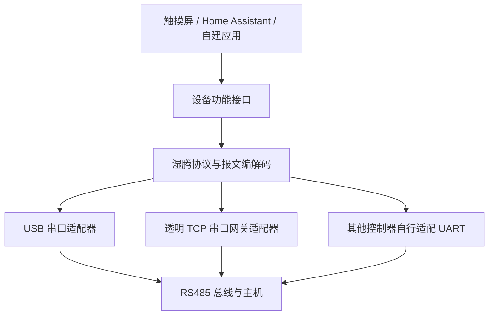

# 湿腾 RS485 协议库 · Shiteng RS485

**这是个人出于兴趣，通过原厂面板与主机的串口抓包及操作对照，逆向分析后独立实现的非官方项目。** 项目不是湿腾（SHITENG）或海克的官方项目、官方 SDK，也不是厂商提供的协议规范；与上述厂商没有官方隶属关系，也未获得官方认可。

把湿腾新风机的指令与面板、串口硬件、Home Assistant 分开。你可以在电脑、网关或可编程面板上复用报文编码和解析逻辑。

**首版为实验性协议库。** 来源是原厂 **STX-W** 面板与一台配套新风主机的通信观察；主机型号尚未登记，不能据此宣称兼容全部湿腾设备。

提供与传输方式无关的 Python 和 Lua 编解码实现。核心不依赖大彩面板、MQTT 或 Home Assistant；传感器候选解释需要使用者明确启用。

## 提供什么

- **协议核心**：帧编码、增量解帧、CRC、控制字段修改；仅处理字节，不访问串口或网络。
- **设备命令**：电源、自动／手动、风速、运行模式、目标湿度，以及观察到的周期报文。
- **传输适配器**：可选 USB 串口（pySerial）、透明串口网关 TCP（Python 标准库）。连接与重连不自动发送控制，不重试结果不明的写入。
- **Lua 参考实现**：独立 Lua 5.1 兼容模块，可用于支持 Lua 的控制器；硬件 API 由使用者适配。
- **协议文档与测试样本**：已观察字段、未知字段、验证范围，以及可跨语言复用的十六进制报文。



ESPHome、Arduino、C++ 和完整 HA 集成尚未在本仓库实现；本库提供它们所需的协议说明与参考代码。MQTT 属于上层网关接入方式，不是这里观察到的原厂串口报文。

## 安装

Python 3.10 或更高版本。从本仓库安装，首版不假定已发布到 PyPI：

```sh
git clone https://github.com/holyful/shiteng-rs485.git
cd shiteng-rs485
python -m pip install .
# 需要 USB 串口时：
python -m pip install ".[serial]"
```

以上命令同样可在 PowerShell 使用。Windows 也可以用 `py -3` 替代 `python`。

## 离线生成与解析

下面只生成字节，不连接设备，也不会开机：

```python
from shiteng_rs485 import Decoder, Fan, Mode, encode_control

wire = encode_control(
    power=True,
    auto=False,
    fan=Fan.MID,
    mode=Mode.INNER_VENT,
)
print(wire.hex(" "))
# 7e 81 00 0a 81 40 14 00 42 e9 0d 0a

decoder = Decoder()
assert decoder.feed(wire[:5]) == []
frame = decoder.feed(wire[5:])[0]
print(frame.kind, frame.payload.hex(" "))
```

修改已知控制载荷时，使用 `patch_control` 保留未知位：

```python
from shiteng_rs485 import Fan, encode_frame, patch_control

# 来自已识别的完整控制载荷，而非任意传感器回包。
previous_payload = bytes.fromhex("81 40 14 00")
updated = patch_control(previous_payload, fan=Fan.HIGH)
wire = encode_frame(0x81, updated)
```

`make_control` / `encode_control` 必须明确给出全部控制字段；默认构造基于已观察到的固定尾字节。没有已知控制载荷时，不应把猜测状态当成设备当前状态。`patch_control` 返回载荷，`encode_frame` 才生成完整帧。

## 接入自己的串口或网关

```python
from shiteng_rs485 import Decoder
from shiteng_rs485.transports import SerialTransport

decoder = Decoder()
with SerialTransport("COM3") as transport:  # Linux 示例："/dev/ttyUSB0"
    chunk = transport.read(256)            # 一次有限等待，只接收
    for frame in decoder.feed(chunk):
        print(hex(frame.kind), frame.payload.hex())
```

`TCPTransport(host, port)` 使用相同的 `read` / `write` 接口，要求对端提供**透明字节流**。它不能直接接大彩屏的 `A5 D0` 诊断服务；那是另一个适配协议。

主动发送需由应用明确调用 `transport.write(wire)`。使用合适的 RS485 收发器并核对设备端电压、针脚和串口设置；不要把 A/B 当作 TTL TX/RX，也不要把面板供电送进 USB 适配器电源端。默认 9600/8N1 来自本次观测；其他设备需先核实。未实现多控制器总线仲裁，已有面板工作时应先被动监听。

完整例子：[`examples/offline.py`](examples/offline.py)、[`examples/listen.py`](examples/listen.py)。监听例子不会发送轮询或控制；设备不主动说话时没有输出是正常的。重连或确定出现数据流中断时调用 `decoder.reset()`，不能把两次连接的半帧拼起来。

## 哪些已经验证

| 功能 | 当前证据 |
|---|---|
| 报文长度、CRC、控制位与风速编码 | 原厂报文与离线测试 |
| 开机、手动风速控制 | 一台主机实测；用户确认低／高档风量变化 |
| 自动／手动、四种模式、目标湿度 55／60 | 原厂面板标记抓包；部分实际执行效果仍待验证 |
| 温度 `A2`、湿度 `A8`、PM2.5 `AC` | **推测字段**，必须显式调用 `decode_experimental` 才会解读 |
| 其他机型、风速停止档、未知回包 | 未验证 |

30–90% 是本库采用的目标湿度参数策略，**不是已经测出的设备完整取值范围**。匹配到 `81 → 01` 相同载荷回复，也不代表风机、阀门或压缩机已经完成动作。

协议使用 CRC-16/MODBUS 的计算方法，但报文格式与 CRC 字节序是这里记录的自定义形式，**不能直接使用标准 Modbus 寄存器驱动替代**。

## 文档与开发

- [协议与字段](docs/protocol.md)
- [分层及移植](docs/architecture.md)
- [兼容性与证据等级](docs/compatibility.md)
- [贡献新的机型与报文](CONTRIBUTING.md)

```sh
python -m pip install -e ".[serial,test,dev]"
python -m unittest discover -s tests -v
python -m build
```

测试使用固定报文、模拟串口和本机回环 TCP，不连接真实主机。Lua 交叉验证通过可选的 `lupa` 运行；未安装时会明确跳过。

MIT 许可证。协议实现、文档和示例在本仓库提供；家庭配置、凭据、原厂固件和厂商开发工具不属于发布内容。

## 分支与版本发布

`main` 是受保护的稳定分支。新功能、修复和文档分别使用 `feat/*`、`fix/*`、`docs/*` 分支，通过 PR 提交；必需检查通过后以压缩合并方式进入 `main`。

CI 在 Linux 的 Python 3.10、3.12、3.14，以及 Windows 的 Python 3.12 上运行测试、离线示例和打包检查。正式版本使用 `v主版本.次版本.修订号` 标签；发布流程确认标签指向 `main` 的提交、重新验证并构建源码包与 wheel，然后发布 GitHub Release。首版不自动上传 PyPI，也不自动更新任何真实设备。

版本变化见 [更新记录](CHANGELOG.md)，维护流程见 [贡献指南](CONTRIBUTING.md)。
